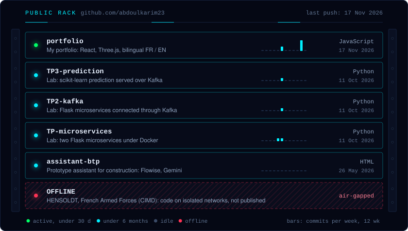

[Français](README.md) · English

# Arkam ALI

AI/ML engineer. I put GenAI systems into production (RAG, semantic search, LLM serving) in on-premise and air-gapped environments, where the cloud is not an option.

This rack is redrawn every day by <a href="scripts/build_rack.py">a Python script</a> in this repository, with no third-party service.

## Offline

Most of my code runs on isolated networks and will stay there. Here is what I can say about it.

**HENSOLDT, June to September 2026.** NCORE AI, a RAG system that finds the NATO Item Name Code of a piece of equipment from its PDF documentation. Deployed in an air-gapped environment on NVIDIA DGX Spark with vLLM. Hit@1 went from 19% to 31%, at about 22&nbsp;s per document.

**French Armed Forces General Staff (CIMD), 2024 to 2027.** Apprenticeship. Semantic search engine and assistant for NATO codification: multilingual-e5-large, FAISS, Mistral.

**Conjectura, since 2026.** Co-founder and CTO. I am building [Planquia](https://planquia.com), which turns construction PDF plans into structured quotations.

## Contact

[Portfolio](https://abdoulkarim23.github.io/portfolio/) · [LinkedIn](https://www.linkedin.com/in/abdoulkarim-ali-25825b212) · [arkam.ali_pro@outlook.com](mailto:arkam.ali_pro@outlook.com)
