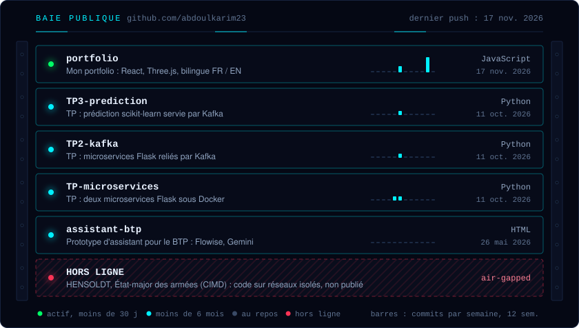

Français · [English](README.en.md)

# Arkam ALI

Ingénieur IA/ML. Je mets en production des systèmes GenAI (RAG, recherche sémantique, serving de LLM) sur des infrastructures on-premise et air-gapped, là où le cloud n'est pas une option.

Cette baie est régénérée chaque jour par <a href="scripts/build_rack.py">un script Python</a> de ce dépôt, sans service tiers.

## Hors ligne

La plus grande partie de mon code tourne sur des réseaux isolés et n'en sortira pas. Voici ce que je peux en dire.

**HENSOLDT, juin à septembre 2026.** NCORE AI, un système RAG qui retrouve le code NATO Item Name d'un équipement à partir de sa documentation PDF. Déployé en environnement air-gapped sur NVIDIA DGX Spark avec vLLM. Hit@1 passé de 19&nbsp;% à 31&nbsp;%, environ 22&nbsp;s par document.

**État-major des armées (CIMD), 2024 à 2027.** En alternance. Moteur de recherche sémantique et assistant pour la codification NATO : multilingual-e5-large, FAISS, Mistral.

**Conjectura, depuis 2026.** Co-fondateur et CTO. Je construis [Planquia](https://planquia.com), qui transforme des plans PDF de construction en devis structurés.

## Contact

[Portfolio](https://abdoulkarim23.github.io/portfolio/) · [LinkedIn](https://www.linkedin.com/in/abdoulkarim-ali-25825b212) · [arkam.ali_pro@outlook.com](mailto:arkam.ali_pro@outlook.com)
